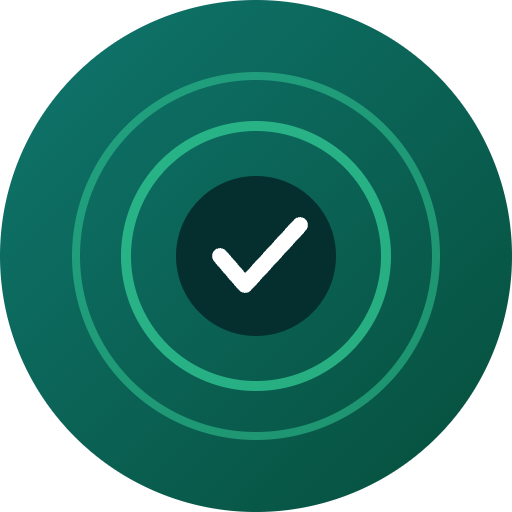

# EchoProof


Crowdsourced, verifiable environmental sensing rewarded on Solana.

## Overview

EchoProof turns everyday smartphones into a DePIN network that captures noise, air quality, or GPS-tagged environmental data, cryptographically proves authenticity, and rewards contributors in SOL/tokens. Data buyers such as cities, researchers, and insurers can query verified datasets on-chain.

## Problem

Environmental and urban data is expensive to collect at scale. Existing datasets are often centralized, stale, or unverifiable, leaving decision-makers without reliable, real-time insight.

## Solution

A mobile app lets users passively collect sensor data, signs it with device attestation to prevent spoofing, and submits proofs to Solana. A token-incentive smart contract rewards honest contribution, while data buyers pay per query to access verified datasets.

## Features (MVP)

- Mobile app for passive sensor data capture (noise/GPS/light)
- On-chain proof-of-contribution and anti-spoofing checks
- Token reward distribution via Solana smart contract
- Marketplace for querying verified datasets by region/time
- Simple map dashboard visualizing live data coverage

## Tech Stack

- React Native (mobile app)
- Anchor + Rust (Solana programs)
- IPFS/Arweave (decentralized raw data storage)
- Solana Pay (payments for data queries)
- PostgreSQL (off-chain indexing)

## How It Works

```
[Smartphone Sensors]
        |
        v
[React Native App] --signs & attests--> [Proof Payload]
        |
        v
[Solana Program (Anchor)] --verifies proof--> [Reward Distribution]
        |
        v
[IPFS/Arweave: Raw Data] <----indexed by----> [PostgreSQL]
        |
        v
[Marketplace] <--query & pay via Solana Pay-- [Data Buyers: Cities, Researchers, Insurers]
```

Users passively capture data, the app signs and attests it on-device, proofs go on-chain for verification and rewards, raw data is stored off-chain, and buyers query the marketplace, paying per request.

## Roadmap

- Partner with a city or university for a pilot data purchase
- Add hardware sensor support (air quality dongles)
- Build reputation-weighted rewards to improve data quality

## Pitch

- [Pitch Deck (PDF)](docs/pitch.pdf)
- [Pitch Script](docs/pitch-script.md)

## Team

- Name — Role — [GitHub](#) / [Twitter](#)
- Name — Role — [GitHub](#) / [Twitter](#)
- Name — Role — [GitHub](#) / [Twitter](#)

---

🎬 Pitch video: [docs/pitch-video.mp4](docs/pitch-video.mp4)
